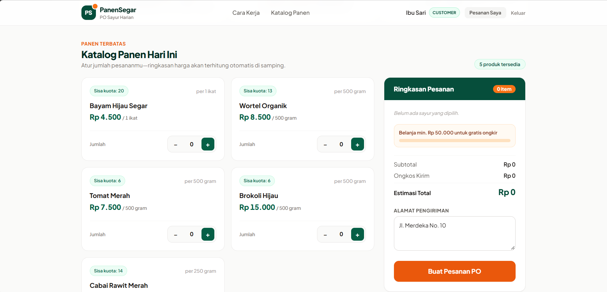
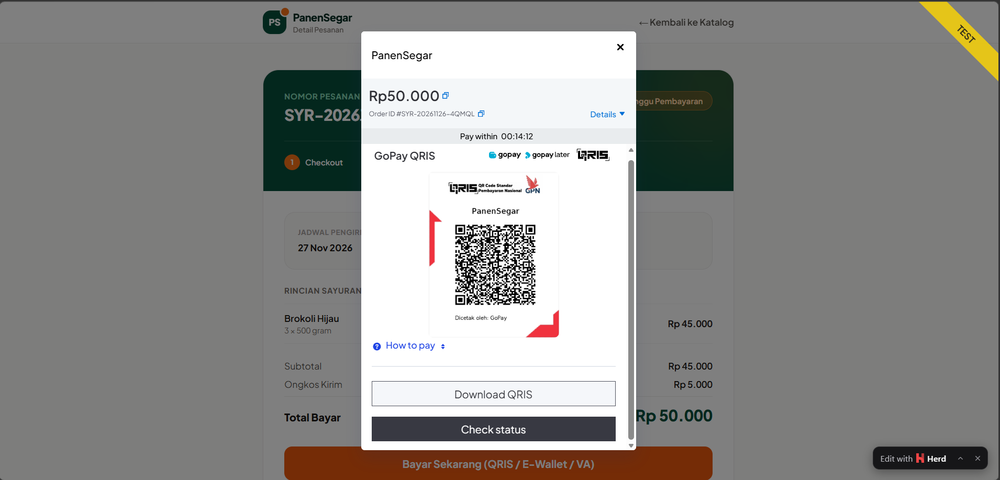
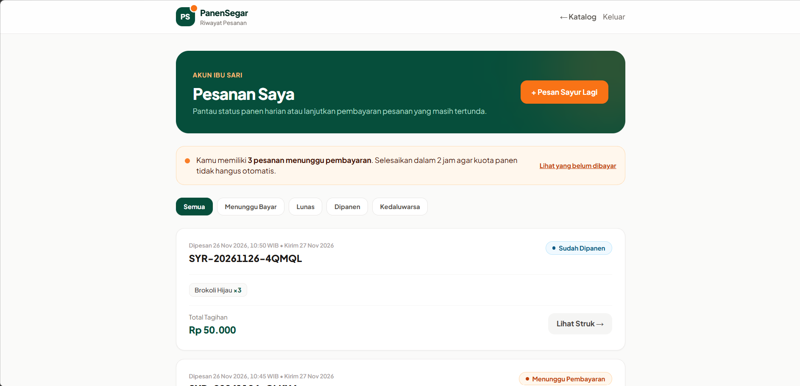
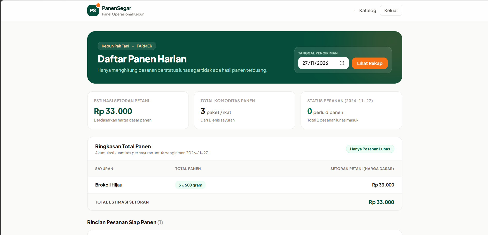

# PanenSegar — Pre-Order Dropshipping Sayur Segar Harian

**PanenSegar** adalah aplikasi web *pre-order* (PO) dropshipping sayuran segar berbasis **Laravel** yang menghubungkan pembeli langsung dengan petani. Sistem dirancang tanpa stok menginap: petani hanya memanen tepat sesuai pesanan yang sudah berstatus lunas untuk menjaga kesegaran produk dan menekan limbah pangan.

---

## Tampilan Aplikasi

### 1. Katalog Panen Harian & Live Checkout Summary


### 2. Struk Pesanan & Pembayaran Midtrans Snap (QRIS / VA / E-Wallet)


### 3. Riwayat Pesanan Pembeli (`/my-orders`)


### 4. Dashboard Operasional Panen Petani (`/farmer/dashboard`)


---

## Fitur Utama

* **Sistem PO H-1 & Cut-Off Otomatis:** Pesanan sebelum pukul **20.00 WIB** dijadwalkan kirim esok hari; pesanan pukul 20.00 WIB ke atas otomatis masuk jadwal lusa.
* **Kalkulasi Server-Side & Gratis Ongkir:** Harga dan subtotal dihitung penuh di sisi server lengkap dengan *price snapshot* agar perubahan harga di kemudian hari tidak mengubah histori transaksi. Ongkir flat Rp 5.000 dan gratis untuk belanja minimal Rp 50.000.
* **Integrasi Midtrans Snap:** Mendukung pembayaran QRIS, E-Wallet, dan Virtual Account beserta pembaruan status otomatis melalui *webhook*.
* **Riwayat Pesanan Pembeli (`/my-orders`):** Pembeli dapat memfilter pesanan berdasarkan status (`pending`, `paid`, `harvested`, `expired`) serta melanjutkan pembayaran tertunda kapan saja sebelum kedaluwarsa.
* **Dashboard Rekap Panen Petani (`/farmer/dashboard`):** Akumulasi kuantitas panen harian per komoditas, kalkulasi estimasi setoran petani berdasarkan harga dasar (`base_price`), filter tanggal kirim, dan pembaruan status ke `harvested`.
* **Otomatisasi Kedaluwarsa Pesanan:** Pesanan `pending` yang melewati batas waktu pembayaran otomatis hangus agar kuota panen harian kembali tersedia bagi pembeli lain.

---

## Arsitektur Keamanan (*Security Hardening*)

Aplikasi ini menerapkan pengamanan berlapis untuk mencegah celah transaksi dan manipulasi kuota:

* **Verifikasi Webhook Midtrans 5 Lapis:** Validasi *SHA-512 signature key*, verifikasi nominal (`gross_amount`), *row locking*, proteksi *idempotency*, serta penanganan status *late payment* (`need_refund`).
* **Anti-Overselling & Anti-Deadlock:** Pengecekan kuota harian dibungkus `DB::transaction()` dengan penguncian baris terurut di level SQL (`orderBy('id')->lockForUpdate()`).
* **Anti-Denial of Inventory:** Pembatasan maksimal 2 pesanan `pending` aktif per pembeli dengan penguncian baris pengguna untuk mencegah *spam* penahanan kuota harian.
* **Rate Limiting:** Middleware `throttle` khusus pada endpoint `/login`, `/register`, dan `/checkout` untuk menahan *brute-force* dan *spam request*.
* **RBAC & Anti-IDOR:** Isolasi akses halaman berdasarkan peran (`customer`, `farmer`, `admin`) serta verifikasi kepemilikan pesanan pada struk dan riwayat transaksi.
* **Safe Error Handling & Dependency Audit:** Detail error integrasi pihak ketiga dicatat ke server log tanpa bocor ke antarmuka pengguna, serta lolos pemeriksaan `composer audit`.

---

## Teknologi yang Digunakan

* **Backend:** PHP 8.x, Laravel
* **Frontend:** Blade Template, Tailwind CSS, Vanilla JavaScript
* **Database:** SQLite / MySQL
* **Payment Gateway:** Midtrans Snap (Sandbox / Production)
* **Testing:** PHPUnit / Laravel Feature Tests

---

## Instalasi Lokal

1. **Clone repositori dan masuk ke direktori proyek:**
   ```bash
   git clone <URL-REPO-GITHUB-KAMU>
   cd dropship-sayur